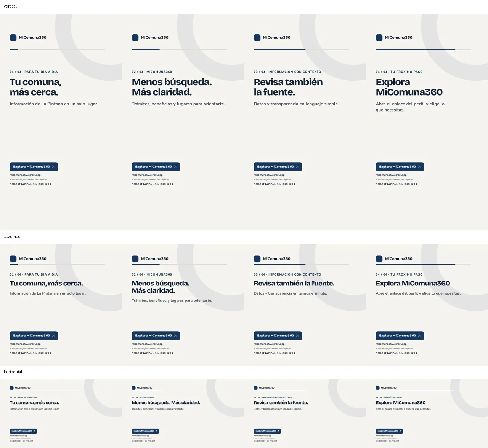
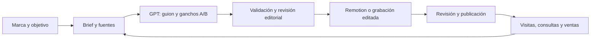

# Estudio de contenido de Fabián

Un sistema de trabajo para crear contenido de **MiComuna360, Monitoreo Intensivo,
el sindicato y futuros negocios**. Reúne planificación, una habilidad para GPT,
video con Remotion, preparación de cortes y seguimiento de resultados.

El objetivo de cada campaña puede ser **informar, promover participación,
generar visitas, recibir consultas o vender**. Cada marca conserva su tono,
audiencia y reglas.





## Prueba el sistema

Necesitas **Node.js 22.18 o superior** y npm. Desde la raíz:

```bash
npm ci
npm run video:instalar
npm run demo
npm run estudio -- render --props trabajo/demo/props-a.json --formato vertical --out trabajo/demo/video-a-vertical.mp4 --ejecutar
```

Esto crea una demostración de MiComuna360 de **24 segundos**, sin llamar a una
API de IA. El video es una pieza animada de texto, **sin sonido por defecto** y
con la indicación «demostración». No se publica automáticamente. Remotion
descarga su navegador si no encuentra uno configurado.

`npm run demo` usa una carpeta nueva: si ya existe `trabajo/demo`, crea otra con
el comando `campana --out trabajo/otro-nombre`. Las salidas nunca reemplazan
tu trabajo por defecto.

Para otros formatos, cambia `--formato` por `cuadrado` u `horizontal` y usa un
nombre de salida diferente. Puedes explorar las cinco composiciones, incluidas
las dos del video original, con `npm run studio`.

Para revisar las cuatro escenas en los tres formatos antes de un render largo:

```bash
npm run video:revisar -- --props trabajo/demo/props-a.json --out trabajo/revision-demo
```

Este comando guarda 12 fotogramas PNG; la decisión editorial sigue siendo tuya.

## Crear contenido con GPT

1. Elige un brief de `ejemplos/`, cópialo a `trabajo/` y edita tema, objetivo,
   audiencia, fuentes y destino. Las identidades viven en `config/marcas.json`.
2. Genera el material para ChatGPT o Codex:

   ```bash
   npm run estudio -- prompt --brief trabajo/mi-brief.json --out trabajo/prompt-gpt.md
   ```

3. Pide a GPT que siga ese archivo y guarda su respuesta como
   `trabajo/contenido-gpt.json`, sin las marcas de un bloque de código.
4. Valida y crea el paquete:

   ```bash
   npm run estudio -- validar --brief trabajo/mi-brief.json --contenido trabajo/contenido-gpt.json
   npm run estudio -- campana --brief trabajo/mi-brief.json --contenido trabajo/contenido-gpt.json --out trabajo/campana-01
   ```

La habilidad [contenido-multimarca](.agents/skills/contenido-multimarca/SKILL.md)
guía a un agente compatible dentro del repositorio. En ChatGPT, el archivo de
prompt permite hacer el mismo trabajo de forma manual. No se crea un GPT en tu
cuenta ni se necesitan claves API para este recorrido. Si prefieres configurarlo
en el editor de GPTs, tienes [instrucciones listas para adaptar](docs/gpt-personalizado.md).

Sin `--contenido`, el comando crea una **plantilla editable**, no una respuesta
generada por IA. Las reglas del JSON comprueban estructura, duración y límites
de texto; las fuentes y afirmaciones requieren revisión editorial.

## Qué entrega una campaña

| Archivo | Para qué sirve |
|---|---|
| `brief.json`, `contenido.json` | Registro de lo que se decidió y escribió |
| `guion.md` | Escenas, locuciones sugeridas, fuentes y pendientes |
| `props-a.json`, `props-b.json` | Dos ganchos para la plantilla Remotion |
| `publicaciones.csv` | Textos, IDs de pieza y enlaces UTM por canal |
| `metricas.csv` | Registro acumulado por publicación, inicialmente vacío |
| `consultas.csv` | Seguimiento por ID, inicialmente vacío |
| `prompt-gpt.md`, `LEEME.md` | Instrucciones para continuar y revisar |

El CSV editorial es propio del sistema. Se puede copiar a una planilla, pero no
es un importador nativo de Metricool. Las UTM etiquetan enlaces; necesitan
analítica en el destino o registro manual para producir datos.

## Una herramienta adicional: Auto-Editor

[Auto-Editor](https://auto-editor.com/) prepara el primer corte de una grabación
según el volumen del audio y puede exportar el montaje a Resolve o Premiere.
Es útil para tutoriales, explicaciones y demostraciones de tus páginas.

Instala el binario oficial siguiendo [la guía de herramientas](docs/herramientas.md).
Después:

```bash
npm run estudio -- cortes --input grabaciones/master.mp4 --modo preview --ejecutar
npm run estudio -- cortes --input grabaciones/master.mp4 --modo video --out trabajo/master-cortado.mp4 --ejecutar
```

Sin `--ejecutar`, `render` y `cortes` solo muestran el plan. El corte no elige los
mejores argumentos ni sustituye la revisión de ritmo y sentido; después de
cortar hay que volver a alinear los subtítulos.

## Organización y siguientes pasos

- [Flujo de trabajo y rutina semanal](docs/flujo-de-trabajo.md).
- [Herramientas actuales y conexiones](docs/herramientas.md).
- [Revisión del repositorio y hoja de ruta](docs/estado-y-hoja-ruta.md).
- [Video original de gasto municipal](videos/micomuna360-gasto-municipal/README.md),
  con voces y subtítulos: conserva su proceso y sus archivos.

`trabajo/`, `grabaciones/`, `privado/`, credenciales y cachés quedan fuera de
Git. El repositorio es público: guarda contactos, nóminas, materiales internos y
documentos de clientes en espacios privados.

Comprobaciones de código: `npm run check` ejecuta las pruebas del flujo y
TypeScript del proyecto de video. GitHub Actions repite esas comprobaciones
sin claves. Los renders y las fuentes se revisan por separado.
El detalle de lo comprobado está en [validación de la entrega](docs/validacion.md).
